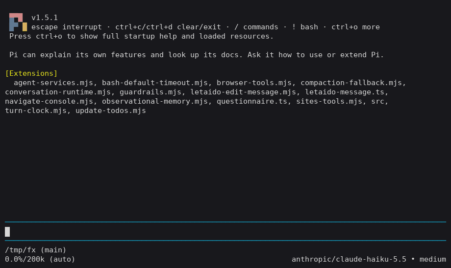

# pi-seo-guard

A [Pi](https://pi.dev) extension that stops the coding agent from silently wrecking your SEO. It diffs every `edit`/`write` of SEO-relevant files **before** it lands, blocks catastrophic changes, and feeds smaller regressions back to the agent so it fixes them in the same turn. Fully offline — no network, no API keys.

## Demo



## Install

```bash
pi install npm:pi-seo-guard
# or try without installing:
pi -e npm:pi-seo-guard
```

## What it does

| Severity | Behaviour |
|---|---|
| **CRITICAL** | The tool call is **blocked** and Pi asks you to confirm (`ctx.ui.confirm`). Declining stops the agent. In headless modes (`-p`, `--mode json`) there is nobody to ask, so it **fails closed** with an explanatory message. |
| **WARN** | The edit goes through; a concise finding is appended to the tool result so the agent fixes it right away. |

## Rules

| Rule id | Default | Detects |
|---|---|---|
| `sitewide-noindex` | critical | `noindex` added to a root layout / `app.html` / `_document`, or an `X-Robots-Tag: noindex` header added in vercel.json / netlify.toml / next.config |
| `robots-disallow-all` | critical | `robots.txt` where `User-agent: *` has `Disallow: /` (and no `Allow: /`) |
| `homepage-removed` | critical | `rm` / `mv` / `git rm` / `git mv` of the homepage route file (blocked up front); for globs / `find -delete` / scripts it is detected after the fact and the agent is told to restore it |
| `unverifiable-critical-write` | critical | a `bash` command writes to `robots.txt` or the root layout in a way the guard can't simulate (see below) |
| `component-noindex` | critical | `noindex` prop added to `<NextSeo>`, `<SEO>`, `<Head>`, `<Meta>`, or an Astro `<Layout>` |
| `title-removed` | warn | `<title>`, Next `metadata.title`, Nuxt `useHead`, or frontmatter `title` removed or emptied |
| `description-removed` | warn | meta description removed or emptied |
| `canonical-removed` | warn | canonical link / `alternates.canonical` removed |
| `noindex-added` | warn | `noindex` added to a single page (meta, Next `robots`, frontmatter) |
| `nofollow-added` | warn | `nofollow` added to robots meta |
| `h1-removed` | warn | file had an `<h1>` / `# Heading` and now has none |
| `img-alt-removed` | warn | more `` / `` without alt than before |
| `route-removed` | warn | route file deleted/renamed (Next app+pages, Astro, SvelteKit, Nuxt) with no matching redirect — also via globs, `find -delete`, `git rm -r`, `rimraf`, node/python scripts (route list is snapshotted around each bash call) |
| `redirect-removed` | warn | redirect rule removed from vercel.json, netlify.toml, `_redirects`, firebase.json, nginx, `.htaccess`, next/astro/nuxt/docusaurus config, SvelteKit `hooks.server` (simple forms) |
| `sitemap-urls-removed` | warn | URLs dropped from `sitemap.xml` |
| `hreflang-changed` | warn | hreflang alternates removed or their URL changed (`<link rel=alternate hreflang>`, Next `alternates.languages`) |
| `jsonld-removed` | warn | a JSON-LD block (`<script type="application/ld+json">`, `<ProductJsonLd/>`-style component) removed |
| `jsonld-invalid` | warn | a literal JSON-LD block is no longer valid JSON |
| `img-dimensions-removed` | warn | more ``/`next/image` without width+height than before (CLS); `fill`, static imports, aspect/size classes, spreads are fine |
| `unverifiable-write` | warn | a `bash` command writes to another watched file (sitemap, redirects, page/layout) in a way the guard can't simulate |

`/seo-guard` additionally uses: `broken-link`, `sitemap-missing-route`, `missing-title`, `missing-description`, `missing-canonical` (all warn).

### Writes through `bash`

Since 0.1.1 the guard also looks at shell commands that modify watched SEO files: `sed -i` / `sed -i.bak` / `perl -pi -e` (simple `s///` is applied in JS), `>` / `>>` redirects of `echo` / `printf` / `cat` / heredocs, `tee [-a]`, `cp` / `mv` onto a watched file, `truncate`, and `bash -c '…'` wrappers. When the result can be computed it goes through the normal rules (e.g. `sed -i 's/Allow/Disallow/' robots.txt` → `robots-disallow-all`). When it can't (complex sed, `$VAR`, command output, scripts), a write to `robots.txt` or the root layout asks for confirmation (headless: blocked), and other watched files get a WARN. Reads (`cat`, `grep`, `sed -n`, `sed` without `-i`) and writes to unwatched paths never trigger.

## Supported frameworks

| Framework | Routes | Title / description / canonical | noindex | Layout inheritance |
|---|---|---|---|---|
| Next.js app router | `app/**/page.*` (also `apps/*/app`) | `metadata` / `generateMetadata`, `<title>`, `<NextSeo>` | `robots` metadata, `<NextSeo noindex>` | nested `layout.*` |
| Next.js pages router | `pages/**` | `<Head>`, `<NextSeo>`, `<SEO>` | same | `_app`, `_document` |
| Astro | `src/pages/**` | `<title>`, `<Layout title description>`, frontmatter | `<meta robots>`, `noindex` prop | imported layouts |
| Nuxt | `pages/**.vue` | `useHead`, `useSeoMeta`, `<Head>` | `meta` robots | `app.vue`, `layouts/*`, `definePageMeta({layout})` |
| SvelteKit | `src/routes/**/+page.svelte` | `<svelte:head>` | `<meta robots>` | `+layout.svelte`, `app.html` |
| Remix | `app/routes/**` (edit checks) | `meta` / `links` exports | `{name:"robots"}` | — |
| Markdown/MDX | page routes | frontmatter (`title`, nested `seo:`) | `noindex: true` | — |

## `/seo-guard`

Scans the project (offline) and reports:

- broken internal links (`<a href>`, `<Link>`, markdown links) that match no route, static file or redirect
- routes missing from `sitemap.xml`
- routes present in git `HEAD` but gone now, with no redirect
- pages missing title / description / canonical (layout-provided values count)

The report is shown in the UI and queued as a hidden message for the agent's next turn.

## Config

Two locations, merged (`.seo-guard.json` wins on conflicts; `ignore` lists concatenate): the original **`.pi/seo-guard.json`** and the tool-agnostic **`.seo-guard.json`** at the project root (also what the CLI / GitHub Action reads).

```json
{
  "baseUrl": "https://example.com",
  "snapshotRoutes": true,
  "ignore": [
    "legacy/**",
    { "rule": "noindex-added", "routes": ["/staging/*"], "paths": ["app/(internal)/**"] }
  ],
  "rules": {
    "h1-removed": "off",
    "title-removed": "critical",
    "noindex-added": "warn"
  }
}
```

- `ignore` strings — globs (`*`, `**`, `?`, `{a,b}`) relative to project root that the guard never looks at. `node_modules`, `.git`, build dirs are always skipped.
- `ignore` objects — **allow-list**: drop findings that match. `rule` is optional (omitted = every non-critical rule); `routes` are globs on the page's route (`/staging/*` covers the subtree), `paths` are globs on the file path. If both are given, either matching suppresses. An entry with only `rule` ignores that rule everywhere. Unknown rule names are discarded (never widened to "all rules").
- `rules` — per rule: `"critical"`, `"warn"` or `"off"`.
- `baseUrl` — absolute links/sitemap `<loc>` under this URL are treated as internal.

Invalid JSON falls back to defaults with a warning.

### Inline ignores

Suppress findings for one file with a comment anywhere in it:

```html
<!-- seo-guard-ignore noindex-added -->
```
```tsx
// seo-guard-ignore title-removed, h1-removed
{/* seo-guard-ignore */}
```

Config entries and inline comments apply to edit-time checks, the CLI and `/seo-guard`.

**Critical rules need an explicit name.** A bare `// seo-guard-ignore` or a rule-less config entry suppresses only *non-critical* rules. `sitewide-noindex`, `robots-disallow-all`, `homepage-removed`, `component-noindex` and `unverifiable-critical-write` guard against de-indexing the whole site, so a wildcard (easy to paste by accident, or for an agent to add just to get past the guard) must never silence them — you have to write e.g. `// seo-guard-ignore sitewide-noindex` or `{"rule": "robots-disallow-all", "paths": ["public/robots.txt"]}`, which is a deliberate, reviewable decision.

## CLI / CI (`pi-seo-guard`)

Runs the same rules without Pi (no Pi install needed):

```bash
npx pi-seo-guard check --base origin/main              # diff working tree vs a git ref
npx pi-seo-guard check --format github --fail-on warn  # annotations, stricter gate
npx pi-seo-guard scan                                  # full scan (like /seo-guard)
```

- `check [--base <ref>] [--format text|json|github] [--fail-on critical|warn|none]` — compares the working tree (incl. untracked files) with the merge-base of `<ref>` and `HEAD` (default `HEAD`; in GitHub PR runs `origin/$GITHUB_BASE_REF`). Old content comes from `git show <ref>:<path>`; added, deleted and renamed files are handled (a deleted/renamed route without a redirect is `route-removed`, the homepage is `homepage-removed`).
- `--format github` prints `::error file=…,line=…::` (critical) / `::warning` (warn) annotations; `json` prints machine-readable findings.
- Exit code: `1` when a finding at/above `--fail-on` exists (default `critical`), `2` on usage/git errors, else `0`.
- `.seo-guard.json` / `.pi/seo-guard.json` (rules, ignore) are honoured.

### GitHub Action

```yaml
# .github/workflows/seo-guard.yml
name: SEO guard
on: pull_request
jobs:
  seo:
    runs-on: ubuntu-latest
    steps:
      - uses: actions/checkout@v4
        with: { fetch-depth: 0 }      # needed to read the base branch
      - uses: RuslanGrigoryev/pi-seo-guard@v0.4.0
        with:
          fail-on: critical           # critical | warn | none
          # base: origin/main         # default: the PR base branch
```

Or without the Action: `- run: npx --yes pi-seo-guard@0.4.0 check --format github`.

## Limits

- **Parsing is lenient, not semantic.** HTML/Astro/Vue/Svelte/JSX go through [htmlparser2](https://github.com/fb55/htmlparser2); Next/Nuxt metadata and frontmatter use **regex**. Titles/descriptions set through indirection are followed since 0.4: same-file `const`s and object properties (`const title = "X"`, `siteConfig.title`), values imported from a relative module or a tsconfig/jsconfig `paths` alias (`@/config/site`, one hop, `const`/`export default` objects), `a || b` fallbacks, and one level of wrapper components that forward props to `<title>`/an SEO component/`useSeoMeta`. If the value resolves to empty/`undefined`/a missing property after an edit, it is reported like a literal removal. Anything else (function calls, `let`/reassigned variables, spreads, package imports, re-exports, props from data) stays "unknown" → counts as present, no finding.
- SEO components are recognised by name (`NextSeo`, `SEO`, `Seo`, `Head`, `Meta`, `*Head`, `*Seo`, Astro `*Layout`).
- Layout inheritance only looks at files edited **in this session** (ledger) and resolvable imports/conventional ancestors; it can't see a title set by a layout in another package.
- Route-deletion snapshots walk the project twice per bash call (disable with `"snapshotRoutes": false` on huge repos). Routes removed *after the fact* can't be blocked, only reported.
- JSON-LD validity is only judged for literal (non-templated) blocks.
- Redirect parsing for `next.config.*`/`astro.config.*`/`docusaurus.config.*` is regex-based on `source:` / path / `from:` keys. SvelteKit `hooks.server` is only understood for `event.url.pathname === '/x'` + `redirect()` and literal redirect maps; arbitrary logic is skipped. nginx/Apache support covers single-line `rewrite`/`Redirect*`/`RewriteRule … [R]` and simple `location … { return 30x }` blocks (no `if`, maps or includes).
- Sitemaps generated at build time (`next-sitemap`, `@astrojs/sitemap`) can't be checked; `/seo-guard` says so.
- Bash write detection is best-effort shell parsing: no variable expansion, globs, `$(…)`, or scripts run via `python`/`node` that write files themselves (those are only caught if they redirect into a watched file). `sed`/`perl` support covers plain `s///` substitutions.
- Only checks what the agent does through Pi's `edit`, `write`, `bash` tools; it is not a build-time linter.

## Development

```bash
npm install
npm test
npm run tsc
pi -e .      # load locally
```

## License

MIT
